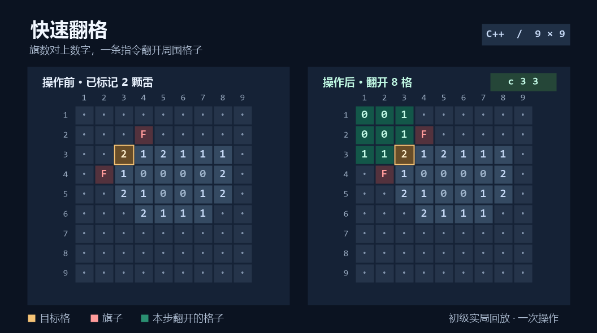

# projects

> 可以独立运行的小项目合集。

## 精选项目 · 终端扫雷

[](minesweeper/)

三档难度，首翻自动展开安全区。标好数字格周围的雷后，一条指令就能翻开剩下的邻格。

[查看玩法和运行步骤](minesweeper/#快速开始) · [浏览 C++ 源码](minesweeper/game/)

## 怎么运行其中一个

```bash
git clone https://github.com/majordanbarry/projects.git
```

进入对应子目录，双击里面的 `.slnx`，按 `F5`。各项目的环境要求和操作说明见它自己的 README。

## 目录约定

- 一个项目一个子目录，目录名用短横线小写。
- 每个项目自带 README、源码与运行说明，可以单独打开。
- 构建产物（`x64/`、`.vs/`、`*.obj`）不入库。
- 新项目达到一定规模、需要独立发布时，再拆成单独仓库。

## 许可

各项目根目录下的 LICENSE 文件分别适用。

学习过程中的小题与语法练习收录在 [coding-journey](https://github.com/majordanbarry/coding-journey)。
