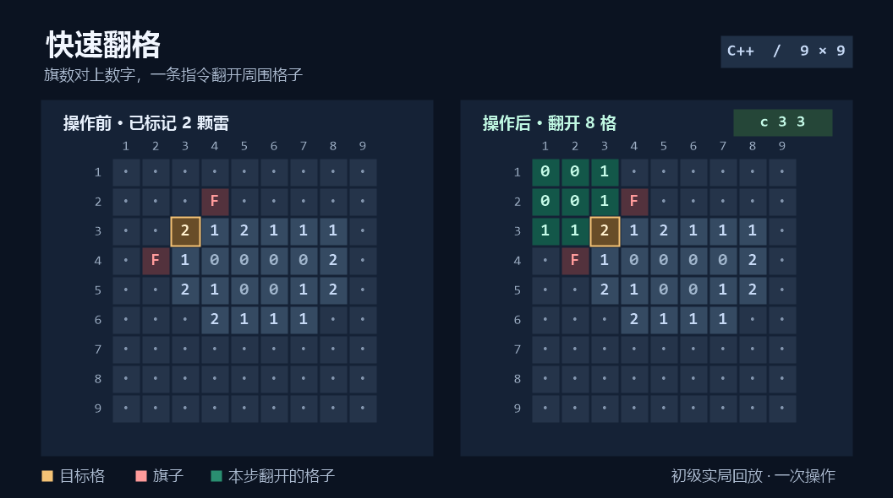
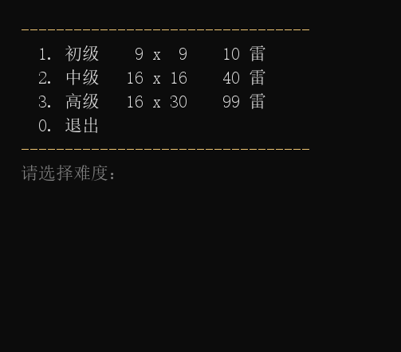

# Minesweeper-CPP · 终端扫雷

用 C++ 写的经典扫雷。第一步就能展开一片安全区，标完周围的雷，一条指令翻开剩下的邻格。



[快速开始](#快速开始) · [操作指令](#操作指令) · [查看源码](game/) · [MIT 许可证](LICENSE.txt)

## 快速开始

1. 安装 Visual Studio 2026，并勾选「使用 C++ 的桌面开发」工作负载。工程使用 MSVC `v145` 工具集。
2. 用以下命令克隆仓库。

   ```bash
   git clone https://github.com/majordanbarry/projects.git
   ```

3. 打开 [game.slnx](game.slnx)（位于克隆后的 `projects/minesweeper` 目录），按 **F5** 运行。
4. 输入 `1`、`2` 或 `3` 选择难度，输入 `0` 退出。

| 难度 | 棋盘 | 雷数 |
| --- | --- | --- |
| 初级 | 9 × 9 | 10 |
| 中级 | 16 × 16 | 40 |
| 高级 | 16 × 30 | 99 |

## 操作指令

| 指令 | 效果 |
| --- | --- |
| `3 5` | 翻开第 3 行第 5 列。首翻时才布雷，点击格和周围一圈都安全。 |
| `f 3 5` | 插旗，再输一次撤旗。旗子用完后，先撤一面才能继续插。 |
| `c 3 5` | 对已翻开的数字格使用。周围旗数等于数字时，翻开其余邻格，算一步。旗子插错可能踩雷。 |

翻开所有安全格就能获胜，踩雷则失败。对局中显示剩余雷数、步数和用时，结束时揭晓雷区。输入 `y` 再玩一局。

<details>
<summary>查看控制台录屏</summary>



</details>

## 代码怎么实现

- [`game/main.cpp`](game/main.cpp) 管理难度菜单、开局和重玩。
- [`game/game.h`](game/game.h) 定义难度配置和棋盘类型。雷区与显示状态分别存入两个二维 `vector`，棋盘尺寸在运行时确定。
- [`game/game.cpp`](game/game.cpp) 负责布雷、翻格、插旗和结算。棋盘外填充一圈，便于统计八邻格。翻到 `0` 时用 DFS 展开，普通翻格和快速翻格共用计步与结算。

后续计划把棋盘规则与控制台交互进一步拆开。

## 相关

[项目合集](../) · [学习练习](https://github.com/majordanbarry/coding-journey)
